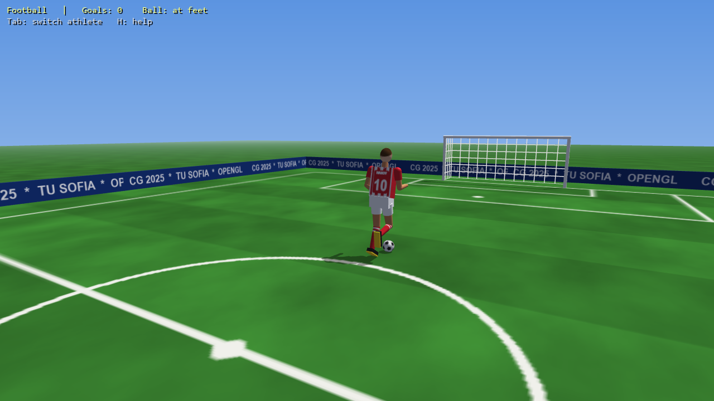
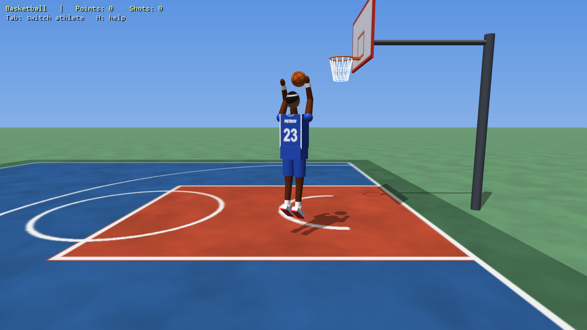

# Animated Athletes – футболист и баскетболист (OpenGL)

Курсов проект по **BCSE51 Компютърна графика** (ТУ – София), тема 1:
*„Animated, textured robot, able to move using mouse and keys“*, реализирана
като два анимирани и текстурирани спортиста:

* **Футболист** – тича, води топката с крака, стреля (Space) и подава (Q) към
  мини-игрище с две врати; голът се отчита автоматично.
* **Баскетболист** – дриблира, тича и стреля със скок (Space) към коша на
  улично игрище; точките (2 или 3) се отчитат автоматично.




## Стартиране

```bash
python -m pip install -r requirements.txt
python main.py
```

Изисквания: Python 3.10+, видеокарта/драйвер с OpenGL 2.1 (compatibility profile).

## Управление

| Клавиш / мишка | Действие |
|---|---|
| W A S D / стрелки | движение (спрямо камерата) |
| Shift | спринт |
| Space / десен бутон | удар (футбол) / стрелба със скок (баскетбол) |
| Q | пас (футбол) |
| R | връщане на топката |
| Tab | смяна на спортиста / сцената |
| ляв бутон + влачене | въртене на камерата, колелце – приближаване |
| H | помощ, F12 – екранна снимка, Esc – изход |

## Използвани техники

* **Йерархично моделиране (scene graph)** – тялото е дърво от стави
  (таз → торс → рамо → лакът → длан …); всяка става има собствена матрица,
  а мировата матрица е произведение на матриците по пътя от корена
  (`core/scenegraph.py`). Същите матрици се използват за права кинематика –
  напр. позицията на дланта, от която тръгва баскетболната топка.
* **Анимация с ключови кадри** – пози (ъгли на ставите) в ключови моменти,
  интерполирани с косинусово „ease-in/ease-out“; огледални пози за втората
  половина на крачката; **плавно преливане (cross-fade)** между клипове и
  синхронизация на фазата при преход ходене ↔ бягане (`core/animation.py`).
* **Слоеве на анимацията** – дриблирането е процедурен слой върху клипа на
  бягане (`Basketballer.post_pose`).
* **Процедурни текстури** – всички текстури се генерират с код (numpy +
  pygame): шумове (fBm value noise), фланелки с номер и име, лица, игрище и
  баскетболен терен по реални размери, футболна топка като претеглена
  сферична диаграма на Вороной (пресечен икосаедър) – `core/textures.py`.
  Използва се mip-mapping (трилинейно филтриране).
* **UV развивки** – собствени генератори на сфера/елипсоид, конус/цилиндър,
  кутия с отделни UV правоъгълници за всяка стена (атлас на фланелката),
  тор (`core/primitives.py`); геометрията се компилира в display lists.
* **Осветление по модела на Phong/Blinn-Phong** (фиксиран конвейер на
  OpenGL), посочена светлина, мъгла, мултисемплинг (MSAA).
* **Планарни сенки** – проекционна матрица върху равнината на терена
  + stencil буфер срещу двойно затъмняване (`core/scene.py`).
* **Физика на топката** – гравитация, отскок, търкаляне без плъзгане
  (въртенето се интегрира от ъгловата скорост), сблъсъци с греди, мрежа,
  ринг и табло; балистично прицелване при стрелба (`core/physics.py`).

## Структура

```
main.py               прозорец, вход, камера, HUD, главен цикъл
core/                 общи модули (математика, примитиви, текстури,
                      scene graph, анимация, физика, базов клас Athlete)
sports/football.py    футболист + сцена „игрище“
sports/basketball.py  баскетболист + сцена „баскетболно игрище“
tools/capture.py      скриптирана демонстрация, записва екранни снимки
tools/dump_textures.py  записва генерираните текстури като PNG
docs/                 документация (DOCX/PDF) и фигури
```

## Разпределение на работата

* **Студент 1** – футболистът: модел и анимации (удар), футболна топка,
  игрище, врати и логика за гол.
* **Студент 2** – баскетболистът: модел и анимации (стрелба, дрибъл),
  баскетболна топка, кош, физика на ринга и табло.
* **Общо** – ядро (scene graph, анимационна система, текстури, камера, сенки).
